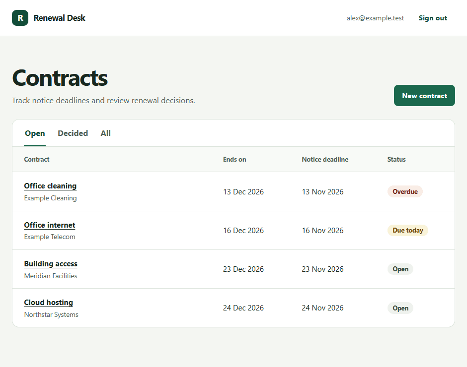

# Renewal Desk

Renewal Desk tracks contract notice deadlines, reminds owners when a decision is due, and records who changed a contract and when.



## Quick start

Requires Docker with Compose v2.

```sh
docker compose up --build --wait
docker compose exec -e SEED_DEMO=1 app bin/rails db:seed
```

Open [Renewal Desk](http://127.0.0.1:3000). Sign in as `alex@example.test` or `jamie@example.test` with the local demo password `renewal-demo`. Alex's demo contracts include a deadline today, deadlines in seven and eight days, an overdue contract, and a recorded decision. Jamie has a separate contract. Demo dates are calculated when the records are created.

## Try a reminder

Compose runs Solid Queue in the `jobs` service. It schedules the reminder job every day at 08:00 Europe/Prague. To see the result immediately, run the same job once:

```sh
docker compose exec app bin/rails runner 'IssueRenewalRemindersJob.perform_now'
```

Open Alex's **Building access** contract to see its reminder. An open contract qualifies when its notice deadline is within seven calendar days or has already passed. Record **Renew** or **Do not renew** to close the contract. The reminder disappears from the page and the decision appears in History and under the **Decided** filter.

## Extract terms from an excerpt

Set `CONTRACT_EXTRACTION_DEMO=1` in the local `.env` file and run `docker compose up --build --wait`. From **New contract**, open **Use a contract excerpt** and select **Find terms** to try the bundled fictional sample. The sample mode works offline.

Live extraction requires an OpenAI API project with access to `gpt-6-luna`. Set `OPENAI_API_KEY` in `.env` and set `CONTRACT_EXTRACTION_DEMO=0`. The app sends the excerpt to the OpenAI Responses API and checks the result against the supplied text. Each suggestion shows the value and its exact source quote. **Apply suggestions** fills the form for review, and **Add contract** saves it. The app stores the contract fields after saving. Manual entry is available throughout. [Model access](https://developers.openai.com/api/docs/models/gpt-6-luna#rate-limits) · [Structured Outputs](https://developers.openai.com/api/docs/guides/structured-outputs)

## API

The API lives under `/api/v1`. It uses the same session as the web interface. Contract reads support `?view=open`, `?view=decided`, and `?view=all`. Mutations require a CSRF token from the signed-in page. Updates and decisions also require the current `lock_version` from the contract response.

For example, run this in the browser console on a signed-in page:

```javascript
const response = await fetch("/api/v1/contracts", {
  method: "POST",
  headers: {
    "Content-Type": "application/json",
    "X-CSRF-Token": document.querySelector('meta[name="csrf-token"]').content
  },
  body: JSON.stringify({
    title: "Office Internet",
    counterparty: "Example Telecom",
    ends_on: "2026-12-31",
    notice_days: 30
  })
});
console.log(response.status, response.headers.get("Location"), await response.json());
```

A successful POST returns HTTP 201 with the contract resource and its `Location`. The full endpoint and error contracts are in the [project specification](PROJECT_SPEC.md#4-контракты-http).

## Checks

```sh
docker compose run --rm -T -e CI=true app bin/ci
docker compose run --build --rm -T -e CI=true browser
docker compose run --build --rm --no-deps -T app bin/test-domain
```

The first two commands mirror GitHub Actions. `bin/ci` runs the domain and integration suites, checks Rails autoloading, and runs RuboCop. The `browser` service runs the full workflow in Chromium on the PostgreSQL test database. The final command runs the domain suite with line and branch coverage without starting a database.

## Implementation

- `Renewals::Contract` owns the transition rules. `Renewals::NoticeSchedule` calculates notice deadlines in the Gregorian calendar.
- `Renewals::ContractWriter` locks the contract row before comparing the submitted version and saves the change and its history event in one transaction.
- `Renewals::IssueReminders` reads candidates in batches and rechecks eligibility under the contract row lock. A PostgreSQL unique index allows one reminder per deadline revision. Edits and decisions control which reminder the contract page displays.

## Local environment

Ruby 3.4.12 · Rails 8.1.4.1 · PostgreSQL 17.12

The web port binds to loopback. The application and Solid Queue use separate databases on the Compose PostgreSQL instance. Set `APP_PORT` to change the host port. Use `docker compose down` to stop the stack and keep the database volume.
